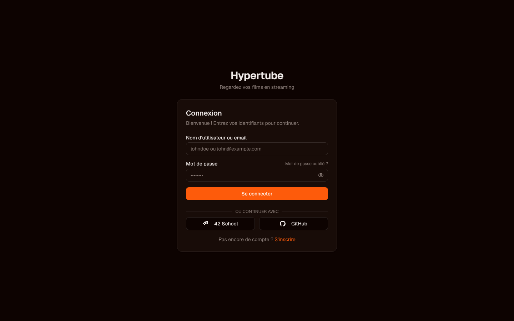
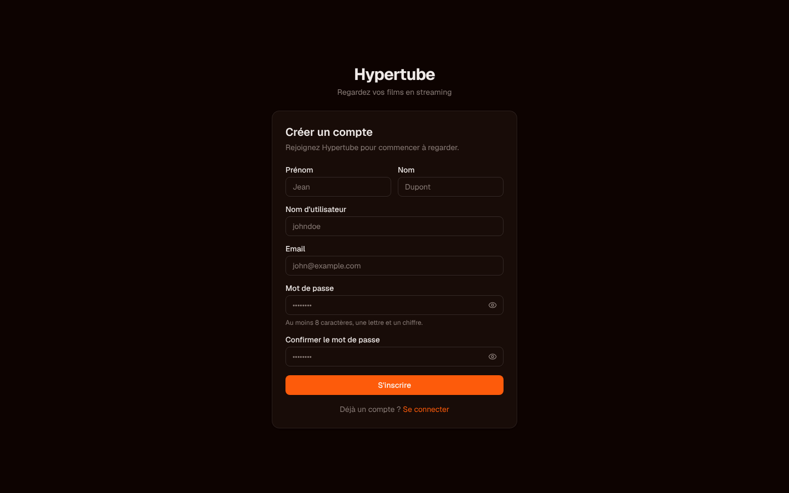
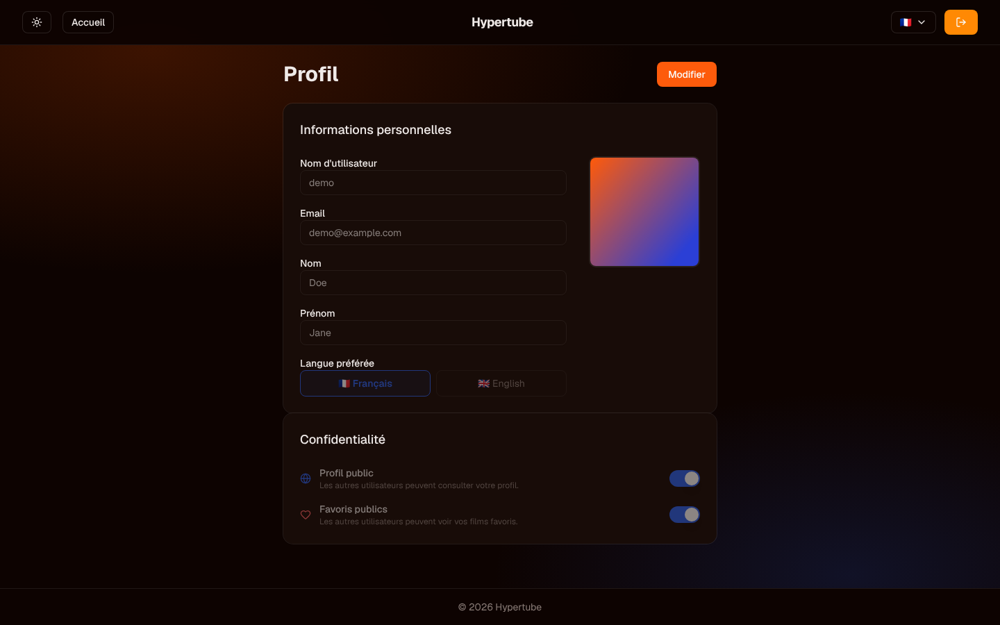

# Hypertube

[](https://github.com/maxg56/hypertube/actions/workflows/ci.yml)

A web application to browse and watch movies via torrent streaming.

## Screenshots

| Login | Sign up | Profile |
|-------|---------|---------|
|  |  |  |

<!-- TODO: add docs/screenshots/catalog.png (movie search) and docs/screenshots/player.png (movie playback),
     captured from a stack with access to the movie APIs (YTS/TMDB). -->

## Architecture

```
Browser
  └── Caddy (reverse proxy :8000/:8443)
        ├── /api/*  → API Gateway (Go, :8080)
        │             ├── auth-service     (:8001)
        │             ├── user-service     (:8002)
        │             ├── library-service  (:8003)  — movie search & metadata (TMDB)
        │             ├── torrent-service  (:8004)  — torrent, stream, subtitles
        │             ├── comment-service  (:8005)
        │             └── worker-service   (:8006)  — background jobs
        └── /*      → Frontend (Next.js, :3000)
```

## Stack

| Layer     | Technology              |
|-----------|-------------------------|
| Frontend  | Next.js 15, TypeScript, Tailwind CSS |
| Gateway   | Go 1.25, Gin            |
| Services  | Go 1.25, Gin, GORM      |
| Database  | PostgreSQL 16           |
| Cache     | Redis 8                 |
| Proxy     | Caddy                   |

## Getting started

**1. Copy the env file and fill in the required values**

```bash
cp .env.example .env
```

Minimum required:

| Variable       | Description                        |
|----------------|------------------------------------|
| `JWT_SECRET`   | Random secret, at least 32 chars   |
| `TMDB_API_KEY` | API key from [themoviedb.org](https://www.themoviedb.org/settings/api) |
| `SMTP_*`       | SMTP credentials for email sending |

**2. Start the stack**

```bash
make
```

The app is available at `https://localhost:8443` (self-signed cert) or `http://localhost:8000`.

**3. Stop / tear down**

```bash
make stop     # stop containers
make down     # stop + remove volumes
make restart  # down then up
```

## API routes

All routes are prefixed with `/api/v1`.

| Prefix              | Service          | Auth required |
|---------------------|------------------|---------------|
| `/api/v1/auth`      | auth-service     | partial       |
| `/api/v1/users`     | user-service     | yes           |
| `/api/v1/library`   | library-service  | yes           |
| `/api/v1/torrent`   | torrent-service  | yes           |
| `/api/v1/stream`    | torrent-service  | yes           |
| `/api/v1/subtitle`  | torrent-service  | yes           |
| `/api/v1/comments`  | comment-service  | yes           |
| `/api/health`       | gateway          | no            |

## Development

Each Go service uses [Air](https://github.com/air-verse/air) for hot reload. Source files are mounted as volumes so changes are picked up without rebuilding the image.

The frontend uses `pnpm dev` with Next.js fast refresh.

**Run the checks locally (same as CI):**

```bash
# Go services
cd api/<service> && go build ./... && go vet ./... && go test ./...

# Frontend
cd frontend && pnpm install --frozen-lockfile && pnpm exec tsc --noEmit && pnpm run build
```

The GitHub Actions workflow (`.github/workflows/ci.yml`) runs these on every push to `main` and on every pull request.

**Rebuild a single service:**

```bash
docker compose -f docker-compose.dev.yml up --build <service-name>
```

## Project layout

```
.
├── api/
│   ├── gateway/          # API gateway — routing & auth middleware
│   ├── auth-service/     # Registration, login, JWT
│   ├── user-service/     # User profiles
│   ├── library-service/  # Movie search via TMDB
│   ├── torrent-service/  # Torrent download + HLS stream + subtitles
│   ├── comment-service/  # Movie comments
│   └── worker-service/   # Background jobs (transcoding, cleanup…)
├── frontend/             # Next.js app
├── docs/screenshots/     # README screenshots
├── services/
│   ├── proxy/            # Caddyfile
│   └── database/         # SQL init scripts
├── volumes/              # Persistent data (git-ignored)
├── docker-compose.dev.yml
├── .env.example
└── Makefile
```
